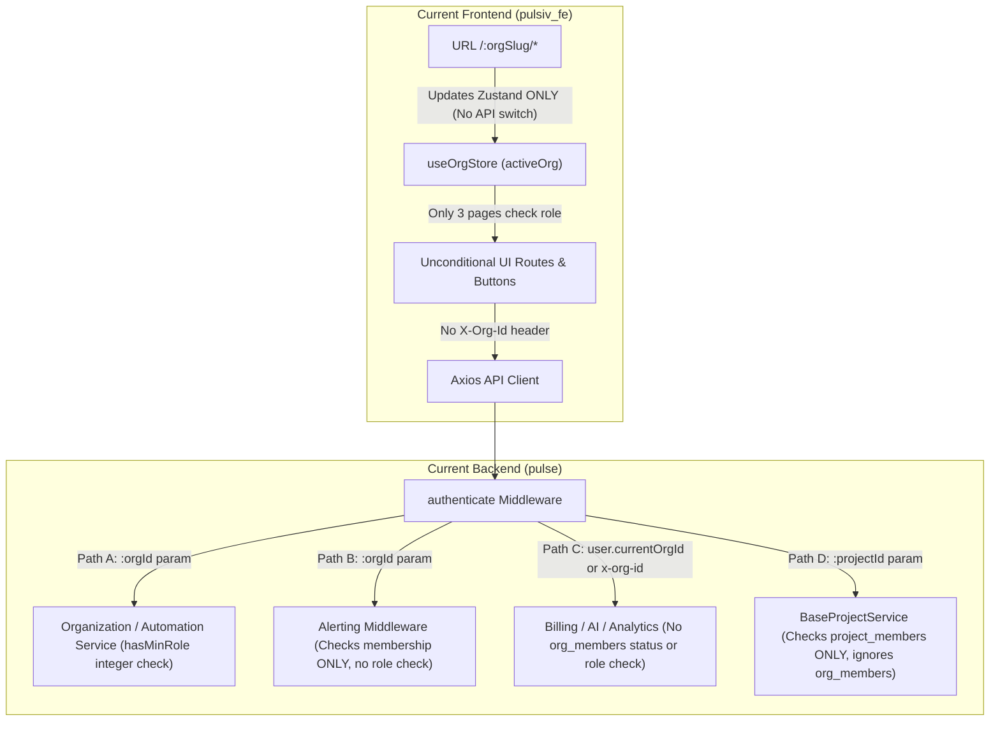
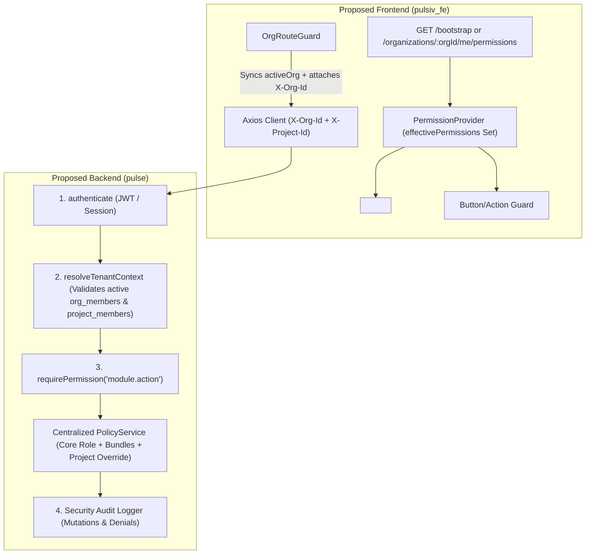

# Pulsiv.dev (Sentinel) RBAC Architecture & Implementation Plan

> **Document Status**: Architecture & Implementation Plan (No Code Modified)  
> **Companion Documents**:  
> - Audit Report: [`docs/security/frontend-route-rbac-audit.md`](./frontend-route-rbac-audit.md)  
> - Permission Matrix: [`docs/security/rbac-permission-matrix.json`](./rbac-permission-matrix.json)

---

## 1. Current vs. Proposed Architecture

### 1.1 Current Architecture & Structural Deficiencies

Currently, authorization across `pulse` (Fastify backend) and `pulsiv_fe` (React + Vite frontend) is fragmented across six disconnected mechanisms:

1. **Fragmented Tenant Context Resolution**:
   - Organization endpoints (`/organizations/:orgId/*`) resolve tenant context from `:orgId` path parameters.
   - Billing (`/billing/*`), Analytics (`/analytics/*`), Ingestion (`/ingestion/*`), and AI (`/ai/*`) resolve tenant context from `request.user.currentOrgId` (populated by JWT/session middleware) or an unvalidated `x-org-id` request header (`billing/entitlements/controller.ts:10-16`).
   - Meanwhile, the frontend `OrgRouteGuard` (`src/app/routes/protected-routes.tsx:227-272`) updates local Zustand state (`setActiveOrg`) when the URL `/:orgSlug` changes **without** calling `POST /organizations/switch`, causing silent tenant desynchronization between the browser URL and `request.user.currentOrgId`.

2. **Flawed 7-Role Linear Integer Hierarchy**:
   - `pulse/src/modules/organization/shared/types.ts:24-50` defines `ROLE_HIERARCHY` as a single linear scale: `owner (100) > admin (80) > developer (60) > security (50) = billing (50) > member (40) > viewer (20)`.
   - Using `hasMinRole(role, 'member')` (`>= 40`) inadvertently grants `billing` (`50`) write access to engineering features, while `hasMinRole(role, 'billing')` (`>= 50`) would grant `developer` (`60`) and `security` (`50`) access to billing operations.

3. **Split-Brain Organization vs. Project Membership**:
   - `BaseProjectService.requireProjectAccess` (`pulse/src/modules/projects/shared/base.service.ts:167-201`) checks `project_members` **without** verifying active `organization_members` status or granting implicit access to Organization `owner` / `admin` roles.
   - Removing a user from an organization (`organization/members/members.repository.ts:119-133`) does not remove their `project_members` rows or clear `users.current_org_id`, leaving orphaned project access and active billing context.

4. **Unprotected Feature Modules**:
   - `/billing/*`, `/organizations/:orgId/alerting/*` (10 submodules), `/observability/errors/*`, `/api/v1/errors/*`, and `/ai/*` enforce `authenticate` (and in alerting, basic org membership) with **zero role or permission checks**, allowing a `viewer` to mutate subscriptions, payment methods, alert rules, incidents, and error groups.

5. **Frontend Decorative/Missing RBAC**:
   - Only 3 frontend pages (`OrgProfilePage`, `OrgSettingsPage`, `TeamPage`) inspect `activeOrg.role`. Over 95% of routes, sidebar items, and destructive buttons render unconditionally for all roles.

---

### 1.2 Proposed Target Architecture

The proposed architecture introduces a **Unified Capability-Based RBAC Model** with **4 Core Hierarchical Roles**, **2 Additive Permission Bundles**, **1 Isolated Platform Role**, and **Deterministic Tenant + Project Resolution**:

#### Key Architectural Pillars:
1. **4 Core Customer Roles (`owner > admin > member > viewer`)**: Clean hierarchical inheritance for general workspace access (`400 > 300 > 200 > 100`).
2. **2 Additive Permission Bundles (`billing_manager`, `incident_responder`)**: Stored as an array `permission_bundles TEXT[]` on `organization_members` (and `organization_invitations`). Eliminates the orthogonal role-ranking collision.
3. **1 Isolated Platform Role (`platform_admin`)**: Evaluated strictly from `users.is_admin === true` via `requirePlatformAdmin()`, completely decoupled from customer `organization_members`.
4. **Unified Effective Permission Resolution**:
   - The backend computes `effectivePermissions: Set<PermissionId>` for `(userId, orgId, projectId?)` in a single `PolicyService` and caches it in Redis (`rbac:perms:{orgId}:{userId}:{projectId || 'org'}`, TTL 60s, invalidated on any membership/role mutation).
   - The `/bootstrap` and `/organizations/:orgId/switch` endpoints return `role`, `permissionBundles`, and `effectivePermissions[]` directly to the frontend so the UI never duplicates role-hierarchy math.

---

## 2. Necessary Backend Changes (`pulse`)

### 2.1 Centralized Permission Registry & `PolicyService`

Create `pulse/src/shared/rbac/`:
- **`permissions.registry.ts`**: Exports strongly-typed `PermissionId` union type and metadata matching `docs/security/rbac-permission-matrix.json`.
- **`role-mappings.ts`**: Maps `owner`, `admin`, `member`, `viewer` and bundles `billing_manager`, `incident_responder` (plus legacy DB enum values during migration) to their exact `PermissionId[]` sets.
- **`policy.service.ts`**:
  - `resolveOrgContext(userId: string, orgId: string)` -> Queries `organization_members` where `organization_id = $1 AND user_id = $2`. **Rejects with `403 Forbidden` if row is missing or `status !== 'active'`** (fixing `[VULN-HIGH-05]` where `'invited'` and `'locked'` were allowed).
  - `resolveProjectContext(userId: string, projectId: string)` -> Fetches project's `organization_id`, verifies `resolveOrgContext(userId, orgId)` is `active`, and computes effective project role:
    - If Org role is `owner` or `admin` -> grants implicit `project_admin` access (`[VULN-CRIT-04]` fix).
    - Otherwise checks `project_members` override or inherits org `member` / `viewer` access.
  - `hasPermission(ctx, permission: PermissionId): boolean` -> Evaluates whether the resolved context includes `permission`.

### 2.2 Reusable Fastify Authorization Guards (`pulse/src/shared/middleware/rbac.ts`)

Replace ad-hoc per-module checks with declarative Fastify `preHandler` guards:

1. **`requireOrgPermission(permission: PermissionId, options?: { requireStepUp?: boolean })`**:
   - Extracts `orgId` deterministically in priority order:
     1. `request.params.orgId`
     2. Verified `request.headers['x-org-id']`
     3. `request.user.currentOrgId`
   - Calls `policyService.resolveOrgContext(request.user.id, orgId)`.
   - Verifies `ctx.effectivePermissions.has(permission)`.
   - If `options.requireStepUp` is true (or defined on the permission metadata for `organization.delete`, `organization.transfer_ownership`, `security.sso.manage`, `security.scim.manage`), enforces step-up MFA token verification.
   - Attaches `request.authz = ctx` so controllers never re-parse `x-org-id` or `currentOrgId`.

2. **`requireProjectPermission(permission: PermissionId)`**:
   - Extracts `projectId` from `request.params.projectId || request.params.id || request.query.projectId || request.headers['x-project-id']`.
   - Calls `policyService.resolveProjectContext(request.user.id, projectId)`.
   - Verifies `ctx.effectivePermissions.has(permission)` and attaches `request.authz = ctx`.

3. **`requirePlatformAdmin()`**:
   - Verifies `request.user.isAdmin === true` against active session/DB state and checks `platform.*` permissions.

### 2.3 Remediating Critical & High Backend Vulnerabilities

| Target Module / File | Required Backend Change | Fixes |
|---|---|---|
| `pulse/src/modules/billing/entitlements/controller.ts:10-16` | Remove unvalidated `request.headers['x-org-id']` trust. Enforce `requireOrgPermission('billing.read')` (or `organization.read` for feature entitlement checks) using verified `request.authz.orgId`. | `[VULN-CRIT-01]` |
| `pulse/src/modules/organization/sdk-config/sdk-config.service.ts:155-240` | 1. Scope Redis cache key to `sdk_config:${orgId}:${environmentId}` and validate environment ownership before cache lookup. 2. Add `requireOrgPermission('sdk_config.draft')` on draft endpoints and `requireOrgPermission('sdk_config.publish')` on publish/rollback/kill-switch endpoints. | `[VULN-CRIT-02]`, `[VULN-HIGH-03]` |
| `pulse/src/modules/billing/routes.ts` & submodules | Attach `requireOrgPermission('billing.read')` to all GET routes (`subscriptions`, `invoices`, `payment-methods`, `usage`, `audit-logs`) and `requireOrgPermission('billing.manage')` to all POST/PATCH/DELETE mutation routes (`checkout`, `change-plan`, `cancel`, `reactivate`, `payment-methods`, `addons`, `coupons`). Move `POST /billing/refunds` to `requirePlatformAdmin()`. | `[VULN-CRIT-03]` |
| `pulse/src/modules/projects/shared/base.service.ts` & `organization/members/members.repository.ts:119-133` | 1. Unify `requireProjectAccess` with `PolicyService.resolveProjectContext` so active `organization_members` is always required and Org `owner`/`admin` have implicit access. 2. Fix `ROLE_RANK` mismatch in `settings.service.ts:95-101`. 3. In `members.repository.ts` (`removeMember` & `suspendMember`), wrap in a DB transaction that deletes/suspends the user's `project_members` rows in that org and clears `users.current_org_id` if it matches `orgId`. | `[VULN-CRIT-04]` |
| `pulse/src/modules/alerting/middleware/auth.middleware.ts` & all 10 alerting route files | Upgrade alerting middleware from bare membership check to action-specific guards: `alerts.read` / `incidents.read` for GETs; `incidents.acknowledge`, `incidents.resolve`, `incidents.comment` for incident mutations; `alerts.silence` for silence mutations; `alerts.dlq.retry` for DLQ retries; `alerts.manage` for rule/escalation/channel/template/route CRUD. | `[VULN-CRIT-05]` |
| `pulse/src/modules/observability/observability.routes.ts` & `pulse/src/modules/errors/errors.routes.ts` | Enforce `requireProjectPermission('errors.triage')` on status changes, resolve/ignore/unresolve/merge/assign/comment routes, and `requireProjectPermission('errors.delete')` on `DELETE /api/v1/errors/groups/:groupId`. | `[VULN-CRIT-05]` |
| `pulse/src/modules/ai/ai.routes.ts` | Enforce `requireOrgPermission('ai.read')` on GET history/usage routes and `requireOrgPermission('ai.use')` on `POST /ai/chat`, `/ai/investigate`, `/ai/explain-error`, `/ai/analyze-logs`, and `/ai/correlate`. | `[VULN-CRIT-05]` |
| `pulse/src/modules/organization/quotas/quotas.service.ts:139` | Replace `requireOwner` on `PATCH /organizations/:orgId/quotas/requests/:requestId` with `requirePlatformAdmin()` (`platform.quotas.review`) so customers cannot self-approve quota increases. | `[VULN-HIGH-01]` |
| `pulse/src/modules/organization/members/members.service.ts:67` | Enforce `canManageRole(caller.role, target.role)` inside `removeMember` so an `admin` cannot remove an `owner` even when `ownerCount > 1`. | `[VULN-HIGH-02]` |
| `pulse/src/modules/automation/service.ts:570` | Enforce `requireOrgPermission('automation.execute')` on `publishEvent` (`POST /automation/events/publish`). | `[VULN-HIGH-04]` |
| `pulse/src/modules/scim/scim.service.ts:26-32` & `organizationservice.ts:295` | Restrict `mapScimRole` to `['admin', 'member', 'viewer']` (never `'owner'`). Enforce seat limit check in `acceptScimProvision`. | `[VULN-HIGH-06]` |

---

## 3. Necessary Frontend Changes (`pulsiv_fe`)

### 3.1 Synchronizing Organization Context (`[VULN-HIGH-07]` Fix)

1. **`src/app/routes/protected-routes.tsx` (`OrgRouteGuard`)**:
   - When `urlOrg.id !== activeOrg.id`, call `bootstrapService.switchOrganization(urlOrg.id)` (or pass `X-Org-Id` on every request) and invalidate org-scoped React Query caches (`queryClient.invalidateQueries()`).
2. **`src/shared/api/interceptors/auth.interceptor.ts`**:
   - Automatically inject `X-Org-Id: useOrgStore.getState().activeOrg?.id` on all outgoing API requests (and `X-Project-Id` when inside `/:orgSlug/p/:projectPublicId/*`).
   - Because the backend `requireOrgPermission` guard validates membership against `X-Org-Id` before falling back to `user.currentOrgId`, multi-tab browsing across two organizations becomes completely race-condition-free.

### 3.2 Centralized Frontend Permission Engine

Create `src/shared/authz/`:
1. **`PermissionContext.tsx` & `usePermissions()` hook**:
   - Consumes `activeOrg.role`, `activeOrg.permissionBundles`, `user.isAdmin`, and `effectivePermissions` from `useBootstrapStore` / `useOrgStore` (with a deterministic local fallback lookup table matching `rbac-permission-matrix.json` if the backend payload only provides `role` + `permissionBundles`).
   - Exposes `can(permission: PermissionId, projectScope?: string): boolean`, `hasRole(minRole: CoreRole): boolean`, and `isPlatformAdmin: boolean`.
2. **`<RequirePermission permission={...} fallback={<AccessDeniedState />} />` Route Guard**:
   - Wraps restricted routes in `src/app/routes/protected-routes.tsx`:
     - `/:orgSlug/admin/settings`, `/:orgSlug/admin/sso`, `/:orgSlug/admin/scim`, `/:orgSlug/admin/security`, `/:orgSlug/admin/audit-logs`, `/:orgSlug/admin/compliance` -> gated by their respective `pagePermission`.
     - `/:orgSlug/billing/*` -> gated by `billing.read` (`owner`, `admin`, or `billing_manager`).
     - `/:orgSlug/super-admin/billing` -> gated by `platform.billing.manage` (`user.isAdmin === true`).
     - `/:orgSlug/projects/new` -> gated by `projects.create`.
     - `/:orgSlug/p/:projectPublicId/keys` and `/:orgSlug/p/:projectPublicId/settings` -> gated by `api_keys.read` and `projects.update`.
3. **`<Can I="permission.id">` Component Guard**:
   - Declarative wrapper for buttons, dropdown items, and form controls across all modules:
     - **Alerting / Incidents**: Hide/disable "Acknowledge", "Resolve", "Add Note" unless `incidents.acknowledge` / `incidents.resolve`; hide "Create Rule", "Edit Rule", "Delete Rule", "New Escalation", "New Channel" unless `alerts.manage`; hide "New Silence" unless `alerts.silence`.
     - **Observability / Errors**: Hide/disable "Resolve", "Ignore", "Assign", "Merge" on `ErrorGroupsPage` and `ErrorGroupDetailPage` unless `errors.triage`; hide "Delete Error Group" unless `errors.delete`; disable `AskAiButton` unless `ai.use`.
     - **Automation**: Hide/disable "New Workflow", "Publish", "Delete" unless `automation.manage`; hide "Approve / Reject" unless `automation.approve`; hide "Run / Retry / Cancel" unless `automation.execute`.
     - **Billing**: Render read-only mode on `PlanPage` and `PaymentMethodsPage` for `admin` (who has `billing.read` but not `billing.manage`), enabling mutation buttons only when `can('billing.manage')` is true.
4. **Navigation & Command Palette Filtering (`AppDualSidebar.tsx`, `PrimaryRail.tsx`, `AvatarDropdown.tsx`, `GlobalSearch.tsx`)**:
   - Filter or badge navigation items based on `can(item.requiredPermission)`.
   - Hide `Super Admin -> Billing Plans` unless `user.isAdmin === true`.

---

## 4. Compatibility Risks & Mitigation

| Risk Area | Impact Description | Mitigation Strategy |
|---|---|---|
| **Legacy DB Roles (`developer`, `security`, `billing`, `qa`)** | Existing rows in `organization_members`, `organization_invitations`, and `project_members` may contain legacy enum values (`developer`, `security`, `billing`, `qa`). | **Dual-Read Compatibility Layer**: `PolicyService` maps legacy roles to their target core role + bundle in memory even before the SQL data migration runs. |
| **Org Admins Locked Out of Existing Projects** | Currently, if a `developer` created a project, only that developer is in `project_members`. Org `owner`/`admin` users were getting `403` on project endpoints. | **Implicit Org Admin Inheritance**: `PolicyService.resolveProjectContext` automatically grants `project_admin` permissions to active Org `owner` and `admin` members. |
| **Existing `admin` Users Expecting Billing Access** | In some organizations, an `admin` may currently manage subscriptions because `/billing/*` had no role checks. | 1. Grant `admin` `billing.read` by default so no dashboard visibility is lost. 2. During migration, optionally grant the `billing_manager` bundle to existing `admin` users in orgs that have an active paid subscription, or notify Org `owner`s that `billing_manager` can be toggled on for specific admins. |
| **Multi-Tab Org Context (`current_org_id` vs URL `:orgSlug`)** | Backend routes relying solely on `request.user.currentOrgId` break or leak across tabs when a user opens two orgs. | Standardized `X-Org-Id` header sent by `auth.interceptor.ts` + validated by `requireOrgPermission` before falling back to `currentOrgId`. |

---

## 5. Database Migration & Rollout Strategy

To preserve existing functionality with zero downtime, database and runtime changes will be rolled out in **4 incremental phases**:

### Phase 1: Additive Schema & Policy Engine Foundation (Zero Breaking Changes)
1. **Additive SQL Migration**:
   - Add `permission_bundles TEXT[] NOT NULL DEFAULT '{}'` to `organization_members` and `organization_invitations`.
   - Backfill `permission_bundles` for existing members:
     - `role = 'owner'` -> `{'billing_manager', 'incident_responder'}`
     - `role IN ('admin', 'developer', 'security')` -> `{'incident_responder'}`
     - `role = 'billing'` -> `{'billing_manager'}`
   - Do **not** drop legacy enum values (`developer`, `security`, `billing`) from `org_role` yet so old and new backend instances remain 100% compatible during rolling deployment.
2. **Deploy `PolicyService` & Shadow Mode Middleware**:
   - Deploy `PolicyService` and `requireOrgPermission` / `requireProjectPermission` with a feature toggle `RBAC_ENFORCEMENT_MODE=shadow|enforce`.

### Phase 2: Immediate P0 Security Hotfixes (Enforced Immediately)
Even while general RBAC is in shadow verification, **immediately enforce** the P0 security fixes:
1. Remove unvalidated `x-org-id` trust in `billing/entitlements/controller.ts`.
2. Fix Redis cache key ordering in `sdk-config.service.ts` (`resolveForSdk`).
3. Enforce `status === 'active'` in `organization_members` across all middlewares (`requireMember`, alerting, billing, projects).
4. Add transactional cascade on member removal/suspension to revoke `project_members` rows and reset `users.current_org_id`.
5. Restrict `PATCH /organizations/:orgId/quotas/requests/:requestId` and `POST /billing/refunds` to `requirePlatformAdmin()`.

### Phase 3: Frontend Permission Gating & Header Synchronization
1. Update `OrgRouteGuard` and `auth.interceptor.ts` to sync active organization context and attach `X-Org-Id`.
2. Deploy `PermissionProvider`, `<RequirePermission>`, and `<Can>` across all frontend pages, sidebars, and modals.
3. Update `TeamPage` and `RolesPermissionsPage` UI to display the 4 core roles (`owner`, `admin`, `member`, `viewer`) and 2 checkboxes/badges for `billing_manager` and `incident_responder`.

### Phase 4: Full Backend Enforcement & Legacy Enum Cleanup
1. Monitor shadow-mode audit logs (`rbac.shadow_deny`) for 48–72 hours to verify zero unexpected false-positive blocks on legitimate customer workflows.
2. Flip `RBAC_ENFORCEMENT_MODE=enforce` across all backend modules (`billing`, `alerting`, `observability`, `errors`, `automation`, `ai`, `projects`, `ingestion`, `connectors`).
3. Run data normalization migration converting remaining `organization_members.role` rows:
   - `'developer'` -> `'member'`
   - `'billing'` -> `'viewer'` (with `permission_bundles = {'billing_manager'}`)
   - `'security'` -> `'admin'`

---

## 6. Testing & Regression Strategy

### 6.1 Unit Tests (`pulse/src/shared/rbac/__tests__/`)
- **Permission Matrix Completeness Test**: Automated test that loads `docs/security/rbac-permission-matrix.json` and verifies every `PermissionId` in the JSON is registered in `permissions.registry.ts` with identical role and bundle mappings.
- **Role & Bundle Evaluation Tests**:
  - Verify `viewer` is denied all write permissions (`*.manage`, `*.create`, `*.update`, `*.delete`, `errors.triage`, `incidents.acknowledge`, `incidents.resolve`, `ai.use`).
  - Verify `viewer` + `billing_manager` is granted `billing.read`, `billing.manage`, `quotas.request`, and denied `projects.create`, `alerts.manage`, `incidents.resolve`.
  - Verify `viewer` + `incident_responder` is granted `incidents.acknowledge`, `incidents.resolve`, `alerts.silence`, `errors.triage`, `automation.execute`, `ai.use`, and denied `billing.*`, `alerts.manage`, `projects.delete`.
  - Verify `admin` is granted `billing.read` and all operational `*.manage` permissions, but denied `billing.manage`, `organization.delete`, `organization.transfer_ownership`, `members.manage_owners`, `security.sso.manage`, `security.scim.manage`, and `platform.*`.

### 6.2 Multi-Tenant & RBAC Integration Test Suite
- **Cross-Tenant IDOR Suite**:
  - Authenticate as `User_A` (Owner of `Org_A`) and replay every parameterized and header-scoped request (`x-org-id: Org_B`, `:orgId = Org_B`, `:projectId = Project_B`, `:environmentId = Env_B`) against `Org_B` resources. Assert `403 Forbidden` or `404 Not Found` (zero data leakage and zero cache poisoning).
- **Member Lifecycle & Revocation Suite**:
  - Add `User_M` to `Org_A` and `Project_A`. Remove `User_M` from `Org_A`. Assert that `User_M` immediately receives `403 Forbidden` on `GET /projects/:projectId`, `POST /projects/:projectId/api-keys`, `GET /billing/subscriptions`, and `GET /observability/logs`.
- **Invited / Suspended Member Suite**:
  - Create an `'invited'` or `'suspended'` membership row and assert `403 Forbidden` on all organization and project endpoints.

### 6.3 Frontend Component & E2E Tests (Vitest + Playwright)
- Render protected routes under mocked `PermissionProvider` states for `owner`, `admin`, `member`, `viewer`, `viewer + billing_manager`, `member + incident_responder`, and `platform_admin`.
- Verify that restricted routes render `<AccessDeniedState />` and restricted buttons are disabled or hidden.
- Verify that navigating from `/:orgSlugA/dashboard` to `/:orgSlugB/dashboard` updates `X-Org-Id` and invalidates stale React Query caches.

---

## 7. Rollback Plan

1. **Runtime Enforcement Rollback (< 1 minute)**:
   - Set environment variable `RBAC_ENFORCEMENT_MODE=shadow` (or `legacy`) via runtime configuration / deployment env.
   - In `shadow` mode, all P0 tenant-isolation fixes (active org membership check, `x-org-id` validation, cache-key scoping, platform-admin guards) **remain active**, while granular role-to-permission checks log warnings instead of returning `403` if an unexpected workflow regression occurs.
2. **Database Rollback**:
   - Because `permission_bundles TEXT[]` is strictly additive and legacy `org_role` enum values (`developer`, `security`, `billing`) are retained during Phases 1–3, rolling back application code requires **zero destructive database down-migrations**.
3. **Frontend Rollback**:
   - `PermissionProvider` supports fallback evaluation from `activeOrg.role` if `effectivePermissions` is absent, allowing independent frontend and backend rollbacks.

---

## 8. Phase Acceptance Criteria

### Phase 1 & 2 Acceptance Criteria (Security & Backend Foundation)
- [ ] `PolicyService` and `requireOrgPermission` / `requireProjectPermission` / `requirePlatformAdmin` guards are implemented and covered by 100% unit test coverage against `rbac-permission-matrix.json`.
- [ ] All 5 Critical (`[VULN-CRIT-01..05]`) and 7 High (`[VULN-HIGH-01..07]`) vulnerabilities have automated regression tests proving exploitation is blocked with `403 Forbidden`.
- [ ] Removing or suspending an organization member atomically revokes their `project_members` access and clears `users.current_org_id`.
- [ ] Org `owner` and `admin` users can access and administer any project within their organization without requiring manual `project_members` rows.

### Phase 3 Acceptance Criteria (Frontend Alignment)
- [ ] Navigating between `/:orgSlug` URLs updates backend/header org context (`X-Org-Id`) and clears stale React Query state.
- [ ] Every route in `protected-routes.tsx` is wrapped with `<RequirePermission>` matching `rbac-permission-matrix.json`.
- [ ] All write buttons across Organization, Billing, Projects, API Keys, Remote Config, Ingestion, Connectors, Observability/Errors, Alerting/Incidents, Automation, and AI are gated by `<Can I="...">`.
- [ ] `/:orgSlug/super-admin/billing` is hidden and inaccessible unless `user.isAdmin === true`.

### Phase 4 Acceptance Criteria (Full Enforcement & Migration)
- [ ] `RBAC_ENFORCEMENT_MODE=enforce` is enabled in production with zero false-positive errors over 72 hours.
- [ ] Legacy roles (`developer`, `billing`, `security`) are migrated to core roles + `permission_bundles` with zero loss of intended access.
- [ ] Security audit logs record actor, role, permission, target resource, and outcome for all sensitive mutations and authorization denials.
